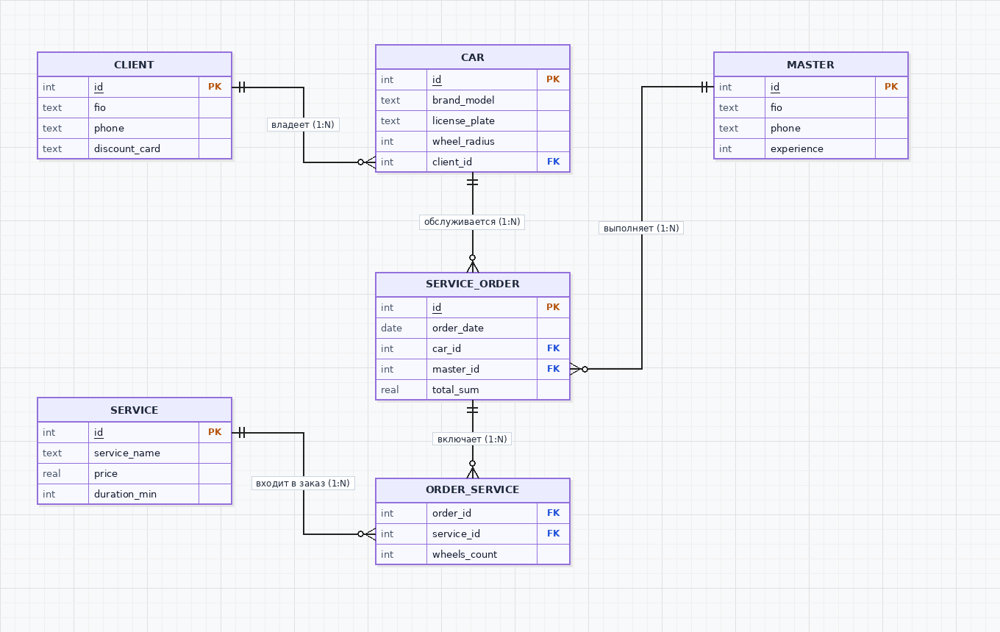

# Практическая работа №1. Анализ предметной области
**Студент:** Василенко Никита, группа 3ИП-12-24
**Предметная область по заданию:** Шиномонтаж

## 1. Выделение сущностей
Для автоматизации работы шиномонтажной мастерской я выделил 5 основных сущностей (плюс связующую таблицу для услуг в заказе):
1. **Клиент (`CLIENT`)** — владельцы автомобилей, которые обращаются в мастерскую.
2. **Автомобиль (`CAR`)** — машины клиентов, для которых выполняются работы (важен радиус колёс, так как от него зависит цена).
3. **Мастер (`MASTER`)** — сотрудники шиномонтажа, выполняющие заказы.
4. **Услуга (`SERVICE`)** — прайс-лист работ (сезонная переобувка, балансировка, ремонт прокола, правка диска).
5. **Заказ-наряд (`SERVICE_ORDER`)** — факт обращения клиента в конкретную дату к конкретному мастеру.

## 2. Атрибуты каждой сущности
| Сущность | Атрибуты | Первичный и внешний ключ |
| --- | --- | --- |
| `CLIENT` (Клиент) | `id`, `fio` (ФИО), `phone` (телефон), `discount_card` (номер скидочной карты) | `id` — PK |
| `CAR` (Автомобиль) | `id`, `brand_model` (марка и модель), `license_plate` (госномер), `wheel_radius` (радиус R14–R21), `client_id` | `id` — PK, `client_id` — FK |
| `MASTER` (Мастер) | `id`, `fio` (ФИО мастера), `phone` (телефон), `experience` (стаж в годах) | `id` — PK |
| `SERVICE` (Услуга) | `id`, `service_name` (название работы), `price` (базовая цена), `duration_min` (время выполнения) | `id` — PK |
| `SERVICE_ORDER` (Заказ) | `id`, `order_date` (дата и время), `car_id`, `master_id`, `total_sum` (итоговая сумма) | `id` — PK, `car_id` и `master_id` — FK |
| `ORDER_SERVICE` (Состав заказа) | `order_id`, `service_id`, `wheels_count` (количество колёс, обычно от 1 до 4) | `order_id`, `service_id` — FK (развязка M:N) |

## 3. Связи между сущностями и их типы
- **Клиент — Автомобиль (1:N):** у одного клиента в семье может быть несколько машин, но конкретный автомобиль в базе закреплён за одним владельцем.
- **Автомобиль — Заказ-наряд (1:N):** одна и та же машина приезжает на сезонный шиномонтаж много раз, но конкретный заказ оформляется на один автомобиль.
- **Мастер — Заказ-наряд (1:N):** один мастер за смену выполняет много заказов, за конкретный заказ отвечает один основной мастер.
- **Заказ-наряд — Услуга (M:N через таблицу `ORDER_SERVICE`):** в один заказ обычно входит сразу несколько услуг (снятие/установка + демонтаж + балансировка + герметик), и одна услуга встречается во множестве заказов. Поэтому связь многие-ко-многим разбита на две связи 1:N через промежуточную таблицу `ORDER_SERVICE`.

## 4. Обоснование выбора сущностей
Такой набор таблиц полностью закрывает реальную работу шиномонтажа: мы знаем, чей автомобиль приехал (`CLIENT` и `CAR`), какой радиус колёс нужно обслужить, какой сотрудник выполнял работу (`MASTER`), какие именно операции и на сколько колёс были сделаны (`SERVICE` и `ORDER_SERVICE`), а также сколько денег поступило в кассу (`SERVICE_ORDER`).

